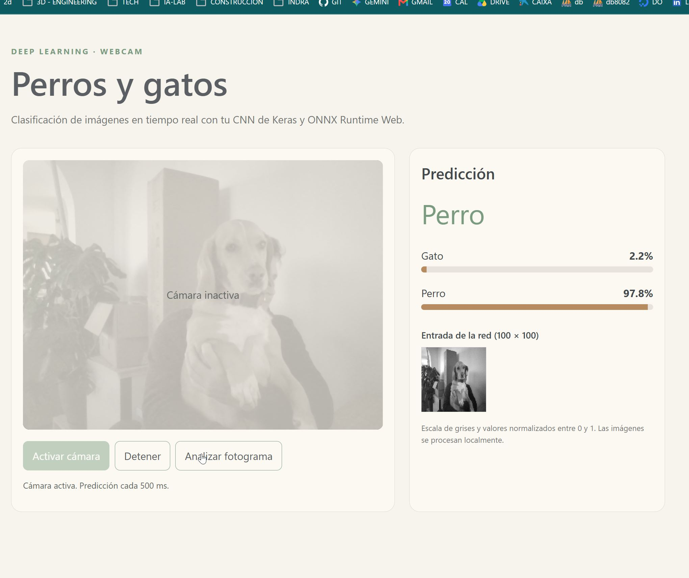
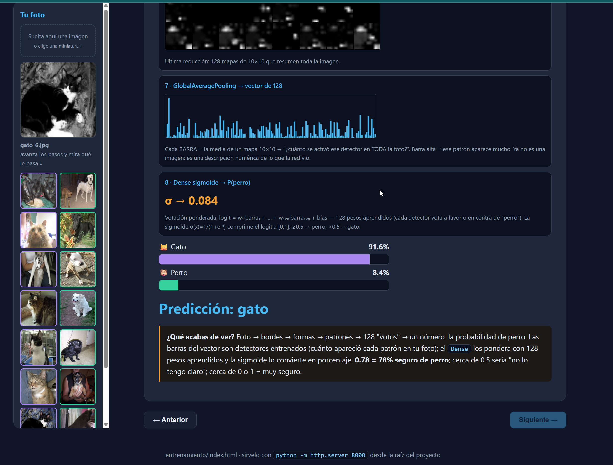

# Keras Cat/Dog Recognizer

Clasificador **perros vs gatos** completo, de principio a fin:

- **Entrenamiento** de una CNN en Keras/TensorFlow (carpeta `entrenamiento/`)
- **Exportación** a ONNX
- **Inferencia en el navegador** con ONNX Runtime Web + webcam — sin servidor de modelos
- **Curso web interactivo** que muestra el paso a paso: foto → matriz → convoluciones → pooling → probabilidad, ejecutando las capas ONNX reales del modelo

## Cómo ejecutarlo

No necesita Node ni PHP — solo un servidor estático:

```powershell
python -m http.server 8000
```

| URL | Qué es |
|---|---|
| `http://localhost:8000/` | App principal: webcam + clasificación en vivo |
| `http://localhost:8000/entrenamiento/` | Curso interactivo + laboratorio de capas |

> La webcam requiere `localhost` o HTTPS (restricción del navegador).

## Capturas

**App principal** — clasificación en vivo por webcam con barras de probabilidad y la entrada de la red (100×100 grises):



**Curso / laboratorio** — la misma foto recorre todas las capas ONNX reales: mapas de activación, vector de 128 y sigmoide final:



## Estructura

```
├── index.html / index.php / app.js / styles.css   # App principal (inferencia webcam)
├── modelo/
│   ├── perros-gatos-cnn-ad3.onnx                  # Modelo desplegado (~375 KB)
│   └── perros-gatos-cnn-ad3-YYYYMMDD.onnx         # Artefactos fechados por run
├── fotos/                                         # 16 miniaturas reales del dataset
└── entrenamiento/
    ├── index.html                                 # Curso interactivo paso a paso
    ├── train.py                                   # Entrenamiento + export ONNX
    ├── requirements.txt
    ├── README.md / README-training.md             # Documentación del pipeline
    ├── capas/s1…s8.onnx                           # Modelos por capa (para el laboratorio)
    ├── checkpoints/modeloCNN3.keras               # Modelo completo (con aumentos)
    └── data/{gatos,perros}/                       # Dataset (solo 20+20 fotos en git)
```

## El modelo

CNN pequeña (~93K parámetros), entrada **100×100 escala de grises normalizada a [0,1]**:

```
Conv2D(32) → MaxPool → Conv2D(64) → MaxPool → Conv2D(128) → MaxPool
→ GlobalAveragePooling → Dropout → Dense(1, sigmoide) = P(perro)
```

- `gato` → 0 · `perro` → 1
- Entrenada con el dataset `cats_vs_dogs` (25K imágenes): **~79% accuracy en validación**
- La app muestra las probabilidades en barras gato/perro cada 500 ms

## El curso (`/entrenamiento/`)

8 pasos interactivos que siguen **tu propia foto** por toda la red: eliges una imagen (o arrastras una tuya) en el panel lateral y ves cómo se transforma — matriz de píxeles, convolución con bordes, pooling… hasta el **laboratorio final**, que ejecuta los 8 modelos ONNX de capa (`capas/s1…s8`) y pinta los **mapas de activación reales** en el navegador.

## Re-entrenar

```powershell
cd entrenamiento
pip install -r requirements.txt
python train.py --data data      # o --tfds para descargar el dataset solo
```

Cada run exporta a `modelo/perros-gatos-cnn-ad3-YYYYMMDD.onnx` y actualiza el archivo canónico que sirve la web. Detalles en `entrenamiento/README-training.md`.
